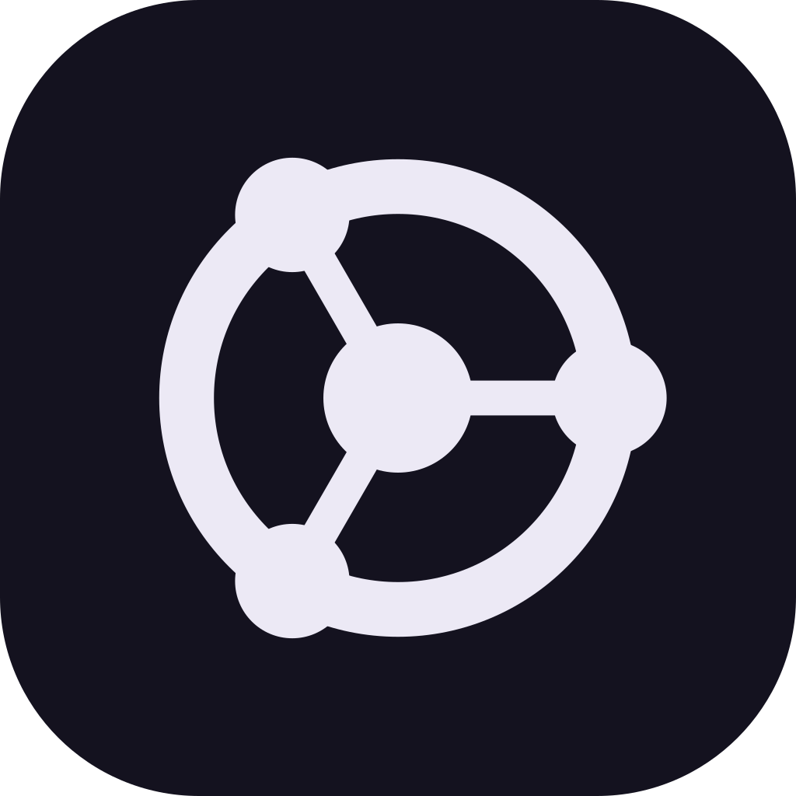

<p align="center">
  
</p>

<h1 align="center">Quanarch</h1>

<p align="center">
  An architecture style between the monolith and microservices.<br>
  <a href="https://quanarch.org">quanarch.org</a>
</p>

Quanarch is an architecture style that sits between the monolith and microservices.
A system is built from three concepts:

- **quan** — a unit of business logic. It cannot run on its own.
- **quanar** — the host that gives quans a place to live. It holds no business logic.
- **qua** — a contract, the only window a quan has into the quanar.

Because a quan never carries its own runtime, the same quans can be folded into a
monolith, plugged into a shared quanar, or each given a quanar of its own — without
rewriting their logic.

Read the full philosophy at **[quanarch.org](https://quanarch.org)**.

This repository contains `quanarch`, the command-line tool (`qu` for short).

> [!NOTE]
> Quanarch is in early development. Commands and file formats may change before 1.0.

## Usage

```sh
qu                       # asks what to create, step by step
qu new quan              # skips the questions you already answered
qu new quan billing
qu check                 # validate conf.qu in the current project
qu version
```

`qu` asks for whatever is missing: what to create, the language, where to put it
and its name. Arrow keys move, enter selects, esc goes back.

| Choice | What you get |
| --- | --- |
| project | A qua, a quanar and a quan, already wired (below). |
| quanar | A host that loads quans and plugs in their quas. |
| quan | Business logic with a manifest: name, version, routes and permissions. |
| qua | A contract: the quanar's core interface and the calls quans make. |
| qmock | A stand-in quanar for developing quans. |
| examples | Complete applications to learn from or start with. |

A quanar, quan or qmock is then asked which qua to use: one from the project's
`packages/`, a new one, a published one (`acme-qua@^1.0.0` or a URL), or none
for now.

A **project** creates the three together, already wired:

```
acme/
├── packages/acme-qua/   the qua: the contract, linked by the others
├── quanar/              the quanar: loads quans and plugs the qua in
└── quans/billing/       a quan: business logic, loaded by the quanar
```

Inside a project, choosing its root as the location puts a quan in `quans/`, a
qua in `packages/` and a qmock in `qmock/`. A new quan gets the next free port,
is added to the quanar's and the qmock's quan list, and if it brings a qua the
quanar does not have yet, `qu` plugs that qua into them too.

Everything `qu` creates describes itself in a [`conf.qu`](docs/conf-qu.md) file.

The tool itself knows nothing about languages or frameworks. Templates come from
**stacks**, separate repositories such as `quanarch-react`, so any language can
join the ecosystem. A stack is described by a [`stack.qu`](docs/stack-qu.md) file;
releases are git tags, fetched once and cached. Git must be installed.

## Building from source

Requires Go 1.25 or later.

```sh
go build -o bin/qu ./cmd/qu
go test ./...
```

## License

Quanarch was created by [Can Berk Coşar](https://berkcosar.com) and is developed at
[Relteco](https://relteco.com).

Licensed under the [Apache License, Version 2.0](LICENSE). See [NOTICE](NOTICE).
